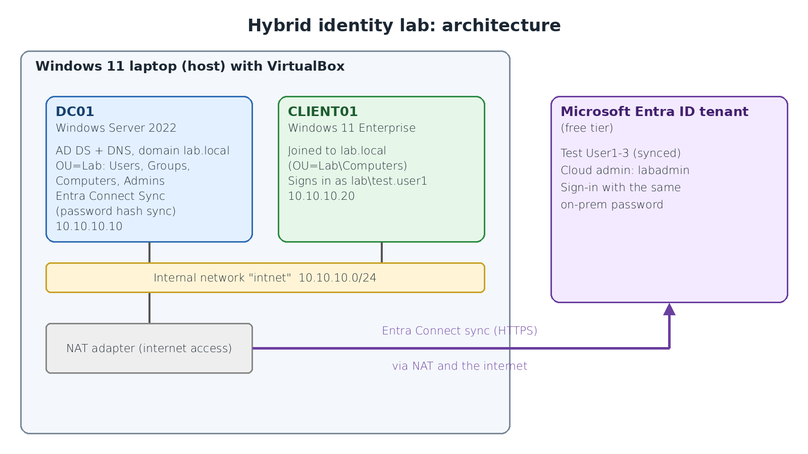

# Hybrid Identity Lab: Active Directory + Microsoft Entra ID

A home lab that connects an on-premises Active Directory domain to a Microsoft Entra ID tenant, so users are created on-prem and sign in to cloud services with the same identity.

**Status:** complete. See the [progress log](docs/progress-log.md) for every step, problem and fix, and the [screenshots](docs/screenshots.md) for the evidence.

## Goal

Build and document a small hybrid identity environment, the same pattern many companies use when moving from on-prem to Microsoft 365 and Azure.

## Architecture



```
+----------------------------+          +--------------------------+
|  On-prem (local VMs)       |          |  Microsoft cloud         |
|                            |          |                          |
|  Windows Server (DC)       |  sync    |  Microsoft Entra ID      |
|  - AD DS, DNS              | -------> |  tenant                  |
|  - Microsoft Entra Connect |          |  - synced users/groups   |
|                            |          |  - cloud sign-in         |
|  Windows client (joined)   |          |                          |
+----------------------------+          +--------------------------+
```

| Machine | Role | Network |
|---|---|---|
| `DC01` | Windows Server 2022: AD DS, DNS, Microsoft Entra Connect Sync | NAT (internet) + internal `intnet`, `10.10.10.10/24` |
| `CLIENT01` | Windows 11 Enterprise, joined to `lab.local` | NAT (internet) + internal `intnet`, `10.10.10.20/24`, DNS `10.10.10.10` |

Everything runs in VirtualBox on one Windows 11 laptop (16 GB RAM).

## Plan

- [x] 1. Prepare the VM environment (hypervisor, virtual network, Windows Server and Windows client VMs)
- [x] 2. Install AD DS and DNS, promote the first domain controller
- [x] 3. Create the OU structure, groups and test users ([scripts](scripts/))
- [x] 4. Set up the Entra ID tenant and add an alternate UPN suffix matching the tenant domain
- [x] 5. Install Microsoft Entra Connect and enable password hash synchronization
- [x] 6. Verify synced users and test cloud sign-in
- [x] 7. Join a client machine to the domain and test sign-in
- [x] 8. Document issues, fixes and lessons learned

## Result

- The three test users created in `OU=Lab` on-prem appear in Microsoft Entra ID, with UPNs on the tenant domain.
- Password hash synchronization is on: a test user signs in to the Microsoft cloud with the same password as on-prem.
- A Windows 11 client is joined to `lab.local` and a domain user signs in to it.

## Lessons learned

- A non-routable on-prem domain suffix (for example `corp.local`) cannot be used for cloud sign-in as it is. Users need an alternate UPN suffix that matches a domain verified in the tenant.
- Scope the sync to a small OU first, then widen it.
- A personal Microsoft account cannot connect Entra Connect. Create a cloud-only Global Administrator in the tenant for the wizard.
- Microsoft no longer publishes the Entra Connect installer on the Download Center. It is downloaded from the Entra admin center.
- Give every VM two network cards: NAT for internet access and an internal network for the lab, with the DC as the only DNS server.
- An unattended Windows 11 install leaves auto-logon on. Switch it off before testing a domain sign-in.
- Never commit passwords, tenant IDs, domain admin credentials or exports with real user data.

## Repository structure

```
.
├── README.md
├── docs/
│   ├── progress-log.md
│   ├── screenshots.md
│   └── images/
└── scripts/
    ├── 01-create-ou-structure.ps1
    └── 02-create-test-users.ps1
```

## Skills used

Active Directory, DNS, Windows Server, Windows 11, Microsoft Entra ID, Microsoft Entra Connect, password hash synchronization, VirtualBox, PowerShell.

---
Dimitris Papadakis · Network & Infrastructure Engineer · Trondheim, Norway
