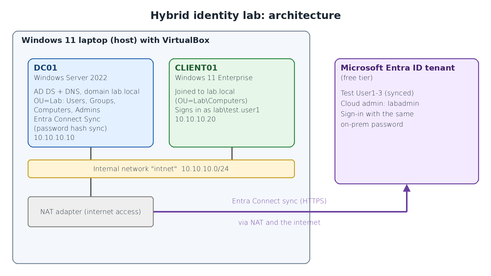
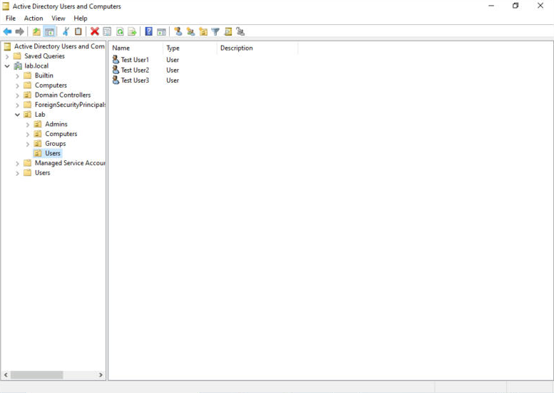
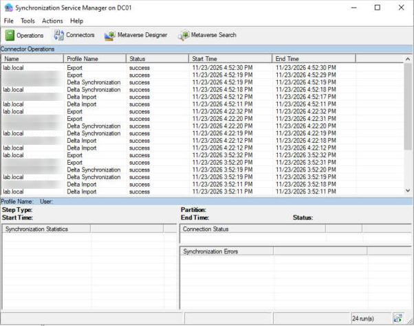
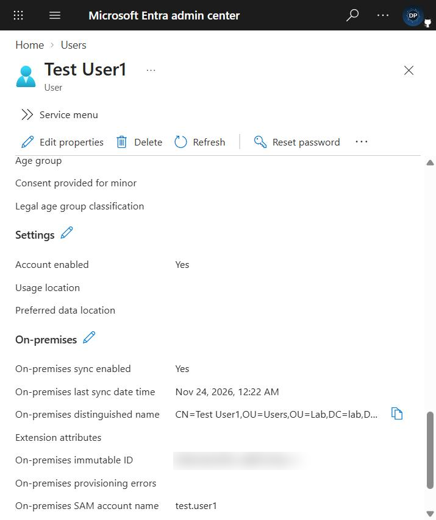

# Screenshots

Evidence for the lab results. Tenant names, emails and IDs are blurred. Image files live in `docs/images/`.

## Architecture

## 1. On-premises Active Directory (DC01)

OU structure `OU=Lab` with the child OUs Admins, Computers, Groups and Users, and the three test users in `OU=Users`:

## 2. Domain-joined client

`CLIENT01` appears in `OU=Lab\Computers` after the domain join:

## 3. Domain sign-in on CLIENT01

Signed in as `lab\test.user1` on `CLIENT01`, domain `lab.local`, with the NAT address and the internal lab address `10.10.10.20`:

## 4. Synchronization on DC01

Synchronization Service Manager on DC01: 24 runs, every Import, Delta Synchronization and Export run on the `lab.local` and tenant connectors finished with status `success` (the tenant connector name is blurred):

## 5. The same user in Microsoft Entra ID

`Test User1` in the Entra admin center: "On-premises sync enabled: Yes", last sync time, distinguished name `CN=Test User1,OU=Users,OU=Lab,...` and SAM account name `test.user1`. The account came from the on-prem directory through Entra Connect, not from the portal (immutable ID blurred):

