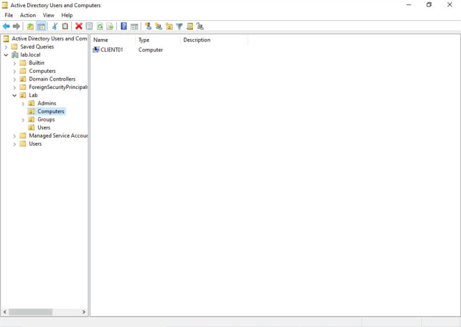
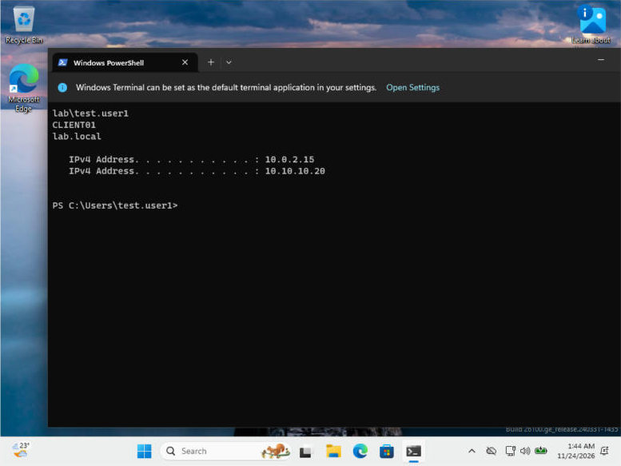

# Screenshots

Evidence for the lab results. Tenant names, emails and IDs are blurred. Image files live in `docs/images/`.

## 1. On-premises Active Directory (DC01)

OU structure `OU=Lab` with the child OUs Admins, Computers, Groups and Users, and the three test users in `OU=Users`:

## 2. Domain-joined client

`CLIENT01` appears in `OU=Lab\Computers` after the domain join:

## 3. Domain sign-in on CLIENT01

Signed in as `lab\test.user1` on `CLIENT01`, domain `lab.local`, with the NAT address and the internal lab address `10.10.10.20`:

